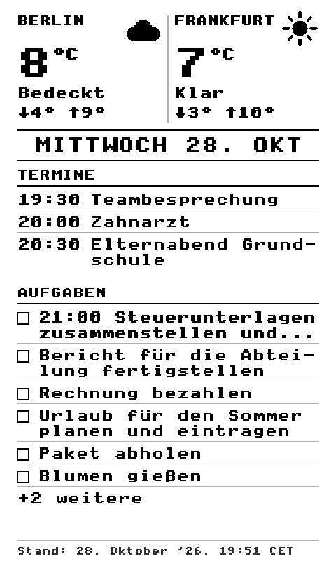
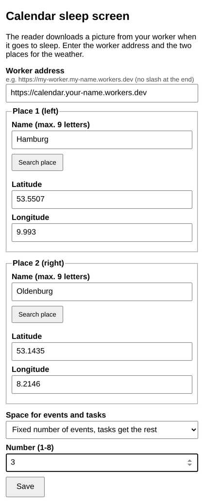

[English](README.md) · **Deutsch** · [Français](README.fr.md) · [Español](README.es.md)

# Kalender-Ruhebildschirm als SD-Plugin für CrossPoint 2.0 (Xteink X4 Pro)

Dein Lesegerät zeigt als Ruhebildschirm deinen Tag: Wetter für zwei Orte, die heutigen Termine aus Google Kalender und
die heutigen Aufgaben aus Todoist. **Dieses Plugin läuft mit der offiziellen CrossPoint-Firmware 2.0**, du brauchst also
keine veränderte Firmware.

   
  <em>Beispiel mit Platzhalterdaten, genau so wie es auf dem Display erscheint (480x800, Graustufen)</em>

> Inoffizielles Community-Plugin. Keine Verbindung zum CrossPoint-Reader-Projekt oder zu Xteink.
> Noch nicht an einem echten Gerät getestet: Bitte melde, was funktioniert und was nicht. Nutzung auf eigene Gefahr,
> keine Gewährleistung.

**Drei Teile, such dir aus, was zu dir passt:**
- ☁️ **Worker** (immer nötig, er zeichnet das Bild): [worker-for-crosspoint-calendar-task-screen](https://github.com/RockyBalboa360/worker-for-crosspoint-calendar-task-screen)
- 🔌 **Dieses Plugin**: für die offizielle CrossPoint-Firmware 2.0, ohne Flashen.
- 🧩 **Alternative: eigene Firmware** mit Menüs am Gerät und einer Galerie für das Warnbild bei leerem Akku:
  [crosspoint-calendar-task-screen](https://github.com/RockyBalboa360/crosspoint-calendar-task-screen/tree/feature/calendar-sleep-screen)
  (Fork von CrossPoint 1.6.5, [aktuelles Release](https://github.com/RockyBalboa360/crosspoint-calendar-task-screen/releases/latest))

## So funktioniert es (in einfachen Worten)
1. Ein kleiner **Worker** im Internet sammelt Wetter, Termine und Aufgaben und zeichnet daraus ein Bild.
   Du richtest ihn einmal ein, die Anleitung steht in seinem README.
2. Dieses **Plugin** ist ein winziger Ordner auf der SD-Karte des Lesegeräts. Er sagt dem Gerät: „Wenn du einschläfst,
   lade das Bild von dieser Adresse und speichere es als `/sleep.bmp`.“
3. Der Ruhebildschirm-Modus **Custom** zeigt `/sleep.bmp` an. Das Bild ist also immer das vom letzten Einschlafen.
4. Die Adresse deines Workers und deine beiden Orte gibst du auf einer **Einstellungsseite** ein, die du im Browser von
   Handy oder Computer öffnest. Du musst keine Dateien bearbeiten.

## Was du brauchst
- Einen Xteink X4 Pro mit **CrossPoint 2.0** (zum Zeitpunkt dieses Textes ist 2.0.0 ein Release Candidate, siehe
  [Releases](https://github.com/crosspoint-reader/crosspoint-reader/releases)). In 1.6.5 gibt es keine Plugins.
- Deinen eigenen **Worker**, der läuft und ein Bild zeigt, wenn du seine Adresse im Browser öffnest.
- Ein gespeichertes WLAN im Lesegerät.

## Installation
**Weg A: mit dem Plugin Hub (empfohlen)**
1. Am Gerät: *Einstellungen → Connectivity → Plugins → Enabled*.
2. *Home → Plugins → Plugin Hub → Install* (das Gerät lädt ihn per WLAN, nur einmal nötig).
3. Plugin Hub öffnen, **Community Plugins** wählen, **Calendar sleep screen** auswählen und *Install* drücken.
   (Das Plugin erscheint dort einige Stunden, nachdem der Repository-Inhaber ein Release veröffentlicht hat.)

**Weg B: von Hand**
1. Dieses Repository herunterladen (*Code → Download ZIP*) oder das aktuelle [Release](https://github.com/RockyBalboa360/CrossPoint-SDPlugin-weather-calendar-task-screen/releases/latest) und entpacken.
2. Den Ordner `calendar-sleep-screen.crosspoint-plugin` als **`/plugins/calendar-sleep-screen`** auf die SD-Karte kopieren
   (umbenennen, ohne den Teil `.crosspoint-plugin`).
3. Am Gerät: *Einstellungen → Connectivity → Plugins → Enabled*.

## Einrichtung (einmalig)
1. *Einstellungen → Display → Sleep Screen → **Custom***.
2. Am Gerät auf dem Startbildschirm **File Transfer** öffnen und *Join a Network* (oder *Create Hotspot*) wählen. Im Browser
   von Handy oder Computer die am Gerät angezeigte Adresse öffnen, zum Beispiel `http://crosspoint.local/settings`.
3. Auf der Seite die Karte **Calendar sleep screen** (Kalender-Ruhebildschirm) suchen, die Adresse deines Workers und
   deine beiden Orte eintragen und **Speichern** drücken. Die Schaltfläche *Ort suchen* findet die Koordinaten für dich
   (dafür braucht Handy oder Computer Internet; im Hotspot-Modus gibst du die Koordinaten von Hand ein).
4. **Das Gerät einmal neu starten.** Ein neues Plugin wird erst beim Start bemerkt. Spätere Änderungen der
   Einstellungen gelten sofort.
5. Das Gerät einschlafen lassen. Vor dem Abschalten verbindet es sich mit dem WLAN, lädt das Bild und zeigt es an.

   
  <em>Die Einstellungskarte im Browser (je nach Browsersprache auf Englisch, Deutsch, Französisch oder Spanisch)</em>

### Was du einstellen kannst
| Einstellung | Bedeutung |
|---|---|
| Adresse des Workers | Die Adresse deines Workers, `https://…workers.dev`, ohne Schrägstrich am Ende. |
| Ort 1 und 2 | Name (höchstens 9 Buchstaben) und Koordinaten. Ort 1 steht links, Ort 2 rechts. |
| Platz für Termine und Aufgaben | Wer den Platz zuerst bekommt, siehe unten. |
| Anzahl | Die Zahl N für die Auswahl „feste Anzahl“ (1 bis 8). |

| Auswahl | Wirkung |
|---|---|
| Alle Termine zuerst | alle heutigen Termine, die Aufgaben bekommen den Rest |
| Feste Terminzahl | genau N Termine, die Aufgaben bekommen den Rest (Standard, N = 3) |
| Feste Aufgabenzahl | genau N Aufgaben, die Termine bekommen den Rest |
| Alle Aufgaben zuerst | alle Aufgaben, die Termine bekommen den Rest |

   
  <em>Die vier Layouts (von links): alle Termine, 2 Termine, 3 Aufgaben, alle Aufgaben</em>

### Ohne Einstellungsseite (Datei bearbeiten)
Die Einstellungen stehen in der Datei `config.json` im Ordner des Plugins (`/.crosspoint/plugins/calendar-sleep-screen/`).
Du kannst sie auch am Computer anlegen: `config.example.json` nach `config.json` kopieren und bearbeiten. Alle Werte
müssen **Text in Anführungszeichen** sein, auch die Zahlen. Den Ortsnamen schreibst du URL-kodiert (`K%C3%B6ln` für Köln).

## Plugin oder eigene Firmware?
| | **Dieses Plugin** (offizielle Firmware 2.0) | **Eigene Firmware** (Fork von 1.6.5) |
|---|---|---|
| Veränderte Firmware flashen | nicht nötig | nötig |
| Offizielle Updates | bleiben möglich | auf neuen Build des Forks warten |
| Einstellungen | Webseite im Browser | Menü am Gerät |
| Galerie für das Warnbild bei leerem Akku und 10-%-Sperre | nein (unter 20 % behält das Gerät das alte Bild) | ja |
| Basis | CrossPoint 2.0 (Release Candidate) | CrossPoint 1.6.5 (stabil) |

## Gut zu wissen
- Das Bild wird als **`/sleep.bmp`** gespeichert. Eine vorhandene `/sleep.bmp` (dein eigenes Ruhebild) wird ersetzt.
- Das Gerät schaltet das WLAN beim Einschlafen ein, aber nur mit gespeichertem Netz und **mindestens 20 % Akku**, und es
  wartet höchstens etwa 10 Sekunden. Klappt das nicht, bleibt das vorherige Bild.
- Das Bild ist deutsch und nutzt die Zeitzone Europe/Berlin (der Worker zeichnet es, die Änderung steht in seinem README).
- Die Adresse des Workers ist öffentlich. Wer sie kennt, sieht deine Termine und Aufgaben. Gib sie nicht weiter.
- Wenn sich das Bild nicht ändert: Prüfe, ob *Plugins* auf *Enabled* steht, *Sleep Screen* auf *Custom*, das Gerät nach
  der Installation neu gestartet wurde, `config.json` existiert und die Adresse des Workers im Browser ein Bild zeigt.

## Lizenz und Quellen
MIT, siehe [LICENSE](LICENSE). Hinweise zu Drittanbietern: [NOTICE.md](NOTICE.md).
Entstanden mit Unterstützung von Claude Code (Anthropic), vom Repository-Inhaber geprüft und veröffentlicht.
